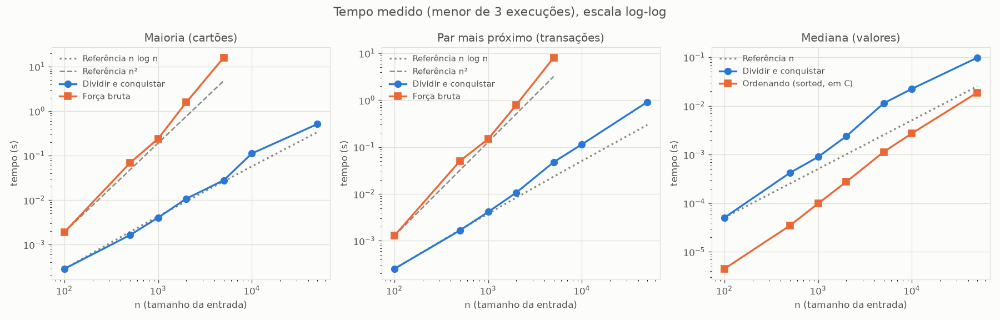

# Detector de Fraude Bancária com Dividir e Conquistar

## Introdução

Projeto da disciplina de Projeto e Análise de Algoritmos (Trabalho 3: Dividir e Conquistar). O sistema apoia uma investigação de fraude bancária usando três algoritmos de dividir e conquistar: **maioria com testador de equivalência** (Kleinberg & Tardos, cap. 5, exercício 3), **par de pontos mais próximo** e **mediana das medianas**.

## Dupla (G44)

| Nome | Matrícula |
|---|---|
| André Ricardo Meyer de Melo | 231011097 |
| Giovanni Dornelas Ferreira  | 232002664 |

## Problema

Um banco abriu uma investigação e tem dois conjuntos de dados: os **cartões apreendidos** com um suspeito e as **transações de um dia** de uma maquininha. O sistema responde três perguntas, cada uma com um algoritmo:

```
1. Mais da metade dos cartões apreendidos é da MESMA conta?     → MAIORIA POR D&C
2. Existe cobrança duplicada (mesmo valor, quase mesmo horário)? → PAR DE PONTOS MAIS PRÓXIMO
3. Quais transações têm valor fora do padrão?                    → MEDIANA DAS MEDIANAS + MAD
```

Fluxo do sistema:

```
Cartões apreendidos → MAIORIA (só com o testador de equivalência) → conta suspeita
Transações          → PAR MAIS PRÓXIMO em (minuto, valor)         → cobrança duplicada
Transações          → MEDIANA DAS MEDIANAS + MAD                  → valores atípicos
```

Cada algoritmo também tem uma versão de força bruta, usada só nos testes (como oráculo) e no benchmark.

## Entrada

Os dados são gerados por [src/dados.py](src/dados.py) com semente fixa (44), então qualquer execução produz os mesmos dados. Os geradores plantam as fraudes que o sistema precisa encontrar.

| Entidade | Campos | Como é gerada |
|---|---|---|
| **Cartão** | `id`, `conta` | `round(n · fração)` cartões na conta suspeita (0, padrão 60%); o resto sorteado entre as contas 1..n |
| **Transação** | `id`, `cartao_id`, `minuto` (0 a 1440, resolução de 1 s), `valor` (R$) | Valores normais em torno de R$ 150 (gaussiana, desvio 40); 1% de fraudes entre R$ 3.000 e R$ 20.000; exatamente uma cobrança duplicada (mesmo cartão e valor, 3 segundos depois) |

O campo `conta` simula o dado criptografado da tarja: os algoritmos **não** o leem. A única forma de comparar cartões é o `TestadorEquivalencia`, que diz se dois cartões são da mesma conta e conta quantas vezes foi chamado.

Cada algoritmo recebe:

| Algoritmo | Entrada |
|---|---|
| Maioria | Lista de cartões e o testador de equivalência |
| Par mais próximo | Lista de transações, usando `(minuto, valor)` como ponto |
| Mediana das medianas | Lista dos valores das transações |

`python src/dados.py` grava exemplos em `data/cartoes_n{n}.csv` e `data/transacoes_n{n}.csv` (n = 100 e 1000). As assinaturas das funções estão em [docs/assinaturas.md](docs/assinaturas.md).

## Análise dos algoritmos

### Maioria por dividir e conquistar (cartões da mesma conta)

- **Problema:** o banco apreendeu n cartões com um suspeito. Cada cartão pertence a uma conta, mas a conta está criptografada na tarja e não pode ser lida. A única operação disponível é o **testador de equivalência**, que recebe dois cartões e diz se são da mesma conta. A pergunta é se existe uma conta com **mais de n/2** cartões, o que indicaria fraude organizada em torno de uma única conta.
- **Por que não dá para ordenar nem usar hash:** as duas técnicas precisam de uma chave comparável (qual conta é "menor", ou um valor para espalhar numa tabela). O testador só responde "igual" ou "diferente". Comparar todos os pares funciona, mas custa n² chamadas. O custo que medimos é justamente o número de chamadas ao testador.
- **Estratégia** ([src/maioria.py](src/maioria.py)):
  - **Dividir:** separar os cartões em duas metades.
  - **Conquistar:** achar recursivamente a conta majoritária de cada metade, se houver. O resultado de cada metade é um *candidato*: um cartão representante.
  - **Combinar:** testar cada candidato (no máximo 2) contra todos os cartões da lista atual. Se algum aparece em mais de n/2 cartões, ele é a resposta; senão, não há maioria.
  - **Casos base:** lista vazia não tem maioria; um cartão sozinho é maioria (1 > 1/2).
- **Por que a resposta sempre está entre os candidatos:** suponha que a conta X tem mais de n/2 cartões no total. Se X tivesse no máximo metade dos cartões em cada metade, teria no máximo ⌊n/2⌋/2 + ⌈n/2⌉/2 = n/2 cartões no total, o que contradiz a hipótese. Logo X é maioria em pelo menos uma metade e volta como candidata dela. O teste no combinar descarta candidatos que são maioria só numa metade.
- **Recorrência:** T(n) = 2T(n/2) + 2n. São duas chamadas recursivas de metade do tamanho, e o combinar faz no máximo 2 candidatos × n chamadas ao testador.
- **Tempo:** pelo Teorema Mestre (a = 2, b = 2, f(n) = Θ(n), caso 2), T(n) = **O(n log n)** chamadas ao testador. Na árvore de recursão, cada um dos ⌈log₂ n⌉ níveis custa no máximo 2n chamadas.
- **Espaço:** O(n) nas sublistas de cada nível, mais a pilha de recursão de profundidade O(log n).
- **Força bruta:** para cada cartão, conta quantos cartões são equivalentes a ele: n × n = **O(n²)** chamadas. Ela é usada só como oráculo nos testes e como comparação de custo.

Chamadas ao testador nos dados gerados (conta suspeita com 60% dos cartões):

| n | Dividir e conquistar | Força bruta (n²) |
|---:|---:|---:|
| 100 | 678 | 10.000 |
| 1.000 | 9.744 | 1.000.000 |
| 10.000 | 134.014 | 100.000.000 |

- **Testes** ([tests/test_maioria.py](tests/test_maioria.py)):
  - lista vazia, um cartão e todos da mesma conta;
  - exatamente n/2 cartões da mesma conta (não é maioria) e n/2 + 1 (é maioria);
  - todas as contas diferentes;
  - maioria concentrada numa única metade;
  - mesmo resultado da força bruta para n de 1 a 80, frações 0,3, 0,5, 0,51, 0,7 e 1,0 e três sementes;
  - a conta suspeita é encontrada nos dados gerados;
  - para n = 1000, no máximo 2n⌈log₂ n⌉ + 2n chamadas, enquanto a força bruta faz n².

### Par de pontos mais próximo (cobrança duplicada)

- **Problema:** uma maquininha registrou n transações num dia. Uma cobrança duplicada (o cliente passou o cartão uma vez e foi cobrado duas) aparece como duas transações com o mesmo valor, registradas com poucos segundos de diferença. Cada transação vira um ponto **(minuto do dia, valor em R$)**, e a cobrança duplicada é o **par de pontos mais próximo**.
- **Escala:** na distância euclidiana, 1 minuto pesa o mesmo que R$ 1. As diferenças que importam são pequenas nos dois eixos (segundos e centavos), então essa escala simples basta. Normalizar pelo mínimo e máximo seria pior, porque as fraudes de valor (até R$ 20.000) esticariam o eixo e esmagariam as diferenças de centavos. Nos dados gerados, a duplicada plantada é o par mais próximo até cerca de 1.000 transações, que é o volume de uma maquininha num dia.
- **Estratégia** ([src/par_proximo.py](src/par_proximo.py)):
  - **Preparar:** ordenar os pontos por x uma única vez, guardando o índice original de cada um. Custa O(n log n).
  - **Dividir:** traçar uma linha vertical x = x_linha com metade dos pontos de cada lado.
  - **Conquistar:** achar recursivamente o par mais próximo de cada metade. Seja δ a menor das duas distâncias.
  - **Combinar:** procurar um par que cruze a linha com distância menor que δ. Só os pontos a menos de δ da linha podem formar esse par (a faixa de largura 2δ). Percorrendo a faixa em ordem de y, cada ponto só precisa ser comparado com os seguintes enquanto a diferença em y for menor que δ.
  - **Casos base:** com até 3 pontos, compara todos os pares.
- **Por que no máximo 7 vizinhos:** divida a faixa em caixas de δ/2 × δ/2. Dois pontos da mesma metade na mesma caixa estariam a menos de δ um do outro, o que contradiz a definição de δ. Logo cada caixa tem no máximo um ponto de cada metade. Um ponto a menos de δ acima de outro está nas duas linhas de caixas seguintes, que somam 8 caixas, então há no máximo 7 vizinhos a examinar. A varredura da faixa custa O(n).
- **Por que devolver a lista ordenada por y:** se cada nível reordenasse a faixa por y, o combinar custaria O(n log n) e o total seria O(n log² n). Em vez disso, cada chamada recursiva também devolve seus pontos ordenados por y, e o combinar faz o **merge** das duas listas em O(n), como no mergesort.
- **Recorrência:** T(n) = 2T(n/2) + O(n): duas metades, mais o merge por y e a varredura da faixa, ambos lineares.
- **Tempo:** pelo Teorema Mestre (caso 2), **O(n log n)**, somando a ordenação inicial por x.
- **Espaço:** O(n) nas listas de cada nível, mais a pilha de recursão de profundidade O(log n).
- **Força bruta:** comparar todos os n(n-1)/2 pares, O(n²). Usada só como oráculo nos testes e como comparação de custo.
- **Resultado nos dados gerados (n = 1000):** transações 11 e 12, ambas do cartão 126, de R$ 148,25, às 00:14:58 e 00:15:01. A distância é 0,05, que corresponde aos 3 segundos entre elas.
- **Testes** ([tests/test_par_proximo.py](tests/test_par_proximo.py)):
  - 2 e 3 pontos;
  - pontos colineares;
  - pontos repetidos (distância 0);
  - todos os pontos com o mesmo x;
  - par que cruza a linha divisória;
  - menos de 2 pontos (erro);
  - mesma distância da força bruta para n de 2 a 300, com pontos reais aleatórios e com uma grade pequena de inteiros, que força x repetidos, pontos iguais e pontos sobre a linha;
  - a cobrança duplicada plantada é encontrada.

### Mediana das medianas e MAD (valores atípicos)

- **Problema:** encontrar as transações com valor fora do padrão. O caminho clássico mede quantos desvios padrão cada valor está da média (z-score). Só que a média e o desvio padrão são puxados pelas próprias fraudes que queremos encontrar. A mediana e o **MAD** (mediana dos desvios absolutos em relação à mediana) quase não se mexem.
- **Exemplo nos dados gerados (1.000 transações, 10 fraudes de valor):**

  | | Média | Desvio padrão | Mediana | MAD |
  |---|---:|---:|---:|---:|
  | Só transações normais | R$ 151,64 | R$ 39,49 | R$ 152,19 | R$ 26,80 |
  | Com as 10 fraudes | R$ 249,41 | R$ 1.105,12 | R$ 153,01 | R$ 27,15 |

  As fraudes multiplicaram o desvio padrão por 28, e o z-score clássico (|z| > 3,5) encontra só **7 das 10** fraudes: elas se escondem atrás do desvio que elas mesmas inflaram. Com mediana e MAD, o escore robusto encontra **as 10**, e nenhuma transação normal é marcada.
- **Por que seleção linear:** a mediana é o elemento de posição n/2 da lista ordenada. Ordenar custa O(n log n), mas achar um único elemento de posição k não exige ordenar tudo: o algoritmo de seleção com mediana das medianas faz isso em **O(n) no pior caso**.
- **Estratégia** de `selecionar(valores, k)` ([src/mediana.py](src/mediana.py)), que devolve o k-ésimo menor valor:
  1. **Dividir** os valores em grupos de 5.
  2. Achar a **mediana de cada grupo**. Ordenar 5 elementos custa uma constante, então o passo todo é O(n).
  3. Achar, recursivamente, a **mediana dessas medianas** (cerca de n/5 valores). Ela é o pivô.
  4. **Particionar** em menores que o pivô, iguais ao pivô e maiores que o pivô. Separar os iguais garante que a recursão diminui mesmo com muitos valores repetidos.
  5. **Descer só no lado que contém k:** nos menores, no pivô (se k cai entre os iguais) ou nos maiores, com k ajustado.
- **Por que o pivô fica entre 3n/10 e 7n/10:** há n/5 grupos, e o pivô é a mediana das medianas, então metade dos grupos (n/10) tem mediana menor ou igual ao pivô. Em cada um desses grupos, 3 dos 5 elementos (a mediana e os dois menores que ela) são menores ou iguais ao pivô. Logo pelo menos 3 · n/10 = 3n/10 elementos são ≤ pivô e, pelo mesmo argumento, pelo menos 3n/10 são ≥ pivô. O lado em que a recursão desce tem, portanto, no máximo 7n/10 elementos.
- **Recorrência:** T(n) ≤ T(n/5) + T(7n/10) + O(n).
  - T(n/5): achar a mediana das medianas (passo 3).
  - T(7n/10): descer no lado escolhido (passo 5), no pior caso.
  - O(n): grupos, medianas dos grupos e partição.
- **Tempo:** como n/5 + 7n/10 = 9n/10 < n, cada nível da recursão processa no máximo 9/10 do anterior. Os custos formam uma série geométrica de razão 9/10, limitada por 10 · cn. Logo T(n) = **O(n)**.
- **Por que grupos de 3 não dão tempo linear** (pergunta do slide): com grupos de 3, a mesma contagem garante só n/3 elementos de cada lado do pivô, e a recorrência vira T(n) ≤ T(n/3) + T(2n/3) + O(n). Agora n/3 + 2n/3 = n: cada nível ainda custa O(n), há O(log n) níveis, e o total é O(n log n), igual a ordenar. Com grupos de 5 a soma fica abaixo de n, e é isso que faz a série convergir. Grupos de 7 também dariam tempo linear, com uma constante diferente.
- **MAD e escore robusto:** `desvio_absoluto_mediano` calcula a mediana, depois os desvios |v − mediana| e depois a mediana desses desvios. São duas seleções lineares, então continua O(n). O escore robusto de cada transação é z = 0,6745 · (valor − mediana) / MAD (Iglewicz e Hoaglin). A constante 0,6745 deixa o MAD na mesma escala do desvio padrão para dados normais. Transações com |z| > 3,5 são marcadas como atípicas. Se o MAD for 0 (mais da metade dos valores iguais), qualquer valor diferente da mediana é atípico.
- **Espaço:** O(n) nas listas da partição e nas medianas dos grupos, mais a pilha de recursão de profundidade O(log n).
- **Força bruta:** ordenar todos os valores e pegar o do meio, O(n log n).
- **Testes** ([tests/test_mediana.py](tests/test_mediana.py)):
  - `selecionar` igual a `sorted(valores)[k]` para n de 1 a 500, com vários k (a ordenação aparece só no teste, como oráculo);
  - muitos valores repetidos, todos iguais, um elemento, lista já ordenada e invertida;
  - a lista original não é alterada;
  - erros para k fora do intervalo e lista vazia;
  - mediana com n par e ímpar;
  - MAD de um exemplo conhecido;
  - um outlier enorme puxa a média e não a mediana;
  - todas as fraudes plantadas são marcadas, com no máximo 1% de outras transações, em ordem decrescente de escore;
  - o caso MAD = 0.

## Saída

`python src/main.py` gera os dados com a semente fixa (1.001 cartões e 1.000 transações) e imprime no terminal o relatório da investigação, em quatro partes:

1. **Dados carregados:** quantos cartões e transações foram analisados e a semente.
2. **Cartões apreendidos:** se existe uma conta com mais da metade dos cartões, quantos cartões ela tem e a porcentagem. Como a conta não pode ser lida, ela é identificada pelo cartão representante devolvido pelo algoritmo. Também mostra quantas chamadas ao testador o dividir e conquistar fez, contra a força bruta.
3. **Cobrança duplicada:** as duas transações mais próximas em (minuto, valor), com id, cartão, horário e valor, a distância entre elas e se ela está abaixo do limiar de suspeita (1,0).
4. **Valores atípicos:** média e desvio padrão (puxados pelas fraudes) contra mediana e MAD (robustos), quantas transações têm |escore robusto| > 3,5 e as 5 com maior escore.

A função `analisar(cartoes, transacoes)` em [src/main.py](src/main.py) faz o mesmo trabalho sem imprimir e devolve um dicionário com todos os resultados, para os testes.

## Exemplo de execução

Saída real de `python src/main.py`:

```text
=== Detector de Fraude Bancária ===

1. Dados carregados
   1.001 cartões apreendidos e 1.000 transações da maquininha (semente 44)

2. Cartões apreendidos: maioria por dividir e conquistar
   A conta do cartão 7 tem 601 dos 1.001 cartões (60,0%): mais da metade
   Chamadas ao testador: 9.717 (dividir e conquistar) x 1.002.001 (força bruta)

3. Cobrança duplicada: par de pontos mais próximo
   Transação 11: cartão 126, 00:14:58, R$ 148,25
   Transação 12: cartão 126, 00:15:01, R$ 148,25
   Distância = 0,050 (suspeita de cobrança duplicada)

4. Valores atípicos: mediana das medianas + MAD
   Média = R$ 249,41 e desvio padrão = R$ 1.105,12 (puxados pelas fraudes)
   Mediana = R$ 153,01 e MAD = R$ 27,15
   10 transações atípicas (|escore| > 3,5). As 5 maiores:
     Transação 680: cartão 129, 16:16:33, R$ 18.016,46, escore 443,9
     Transação 507: cartão 140, 11:47:09, R$ 16.627,11, escore 409,3
     Transação 725: cartão 198, 17:18:16, R$ 14.527,77, escore 357,2
     Transação 22: cartão 21, 00:28:16, R$ 13.862,11, escore 340,6
     Transação 967: cartão 88, 23:15:15, R$ 10.126,94, escore 247,8
```

As três fraudes plantadas nos dados foram encontradas: a conta suspeita (60% dos cartões), a cobrança duplicada de R$ 148,25 com 3 segundos de diferença e as 10 transações de valor fraudulento, sem nenhum falso positivo.

## Resultados experimentais

[src/benchmark.py](src/benchmark.py) mede cada algoritmo de dividir e conquistar e a sua força bruta para n = 100, 500, 1.000, 2.000, 5.000, 10.000 e 50.000.

- **Como foi medido:**
  - cada tempo é o **menor de 3 execuções**, com o coletor de lixo desligado durante a medição, como faz o `timeit`;
  - a geração das entradas fica fora da medição;
  - as forças brutas O(n²) rodam só até n = 5.000; acima disso, levariam minutos;
  - na mediana, a comparação é com "ordenar e pegar o meio" usando o `sorted()` do Python.
- **Dados brutos:** [data/resultados_benchmark.csv](data/resultados_benchmark.csv).
- **Ambiente:** os tempos absolutos variam entre máquinas.



**Tempos (em milissegundos):**

| n | Maioria D&C | Maioria força bruta | Par D&C | Par força bruta | Mediana das medianas | Ordenando (`sorted`) |
|---:|---:|---:|---:|---:|---:|---:|
| 100 | 0,29 | 1,91 | 0,25 | 1,28 | 0,05 | 0,004 |
| 500 | 1,64 | 68,21 | 1,67 | 50,44 | 0,42 | 0,035 |
| 1.000 | 4,04 | 240,72 | 4,13 | 148,38 | 0,90 | 0,099 |
| 2.000 | 10,80 | 1.579,32 | 10,70 | 795,29 | 2,39 | 0,276 |
| 5.000 | 27,88 | 15.880,52 | 47,71 | 8.072,73 | 11,31 | 1,133 |
| 10.000 | 111,65 | — | 114,13 | — | 22,46 | 2,727 |
| 50.000 | 510,79 | — | 916,80 | — | 98,07 | 18,865 |

**Chamadas ao testador de equivalência (maioria):**

| n | Dividir e conquistar | Força bruta | Força bruta ÷ D&C |
|---:|---:|---:|---:|
| 100 | 678 | 10.000 | 15x |
| 500 | 4.366 | 250.000 | 57x |
| 1.000 | 9.744 | 1.000.000 | 103x |
| 2.000 | 21.524 | 4.000.000 | 186x |
| 5.000 | 62.344 | 25.000.000 | 401x |
| 10.000 | 134.014 | — | — |
| 50.000 | 788.383 | — | — |

**Crescimento medido x teoria** (quantas vezes o custo aumentou quando n cresceu):

| Intervalo | Teoria | Maioria D&C (chamadas) | Maioria D&C (tempo) | Par D&C | Mediana das medianas | `sorted` |
|---|---|---:|---:|---:|---:|---:|
| 1.000 → 10.000 | n log n: 13,3x; n: 10x | 13,8x | 27,7x | 27,6x | 25,1x | 27,6x |
| 10.000 → 50.000 | n log n: 5,9x; n: 5x | 5,9x | 4,6x | 8,0x | 4,4x | 6,9x |
| 100 → 1.000 (força bruta) | n²: 100x | 100x | 125,9x | 115,8x | — | — |

**Análise:**
- **Contagem de chamadas:** é a medida mais limpa, porque não depende da máquina. As chamadas do dividir e conquistar crescem como n log n (13,8x contra 13,3x previstos, e 5,9x contra 5,9x). As da força bruta são exatamente n². Em n = 5.000, o dividir e conquistar faz 401 vezes menos chamadas.
- **Ganho em tempo, em n = 5.000:** o dividir e conquistar é cerca de 570 vezes mais rápido na maioria e 170 vezes mais rápido no par mais próximo. A diferença aumenta com n, e as retas do gráfico se afastam porque as inclinações são diferentes: cerca de 1 para n log n e 2 para n².
- **Crescimento acima da teoria entre 1.000 e 10.000:** os tempos cresceram cerca de 27x, o dobro do previsto. Isso também aconteceu com o `sorted()`, que é implementado em C e independe do nosso código. Por isso, o excesso vem da máquina, não dos algoritmos: com 1.000 elementos os dados cabem no cache do processador, e com 10.000 já não cabem. Entre 10.000 e 50.000, quando os dados já estão fora do cache nos dois tamanhos, os tempos voltam a acompanhar a teoria. O mesmo efeito explica a força bruta crescer um pouco acima de n² entre 1.000 e 5.000.
- **Mediana em tempo absoluto:** o `sorted()` é mais rápido que a mediana das medianas, de 5 a 13 vezes nesta máquina. O motivo é que ele roda em C, enquanto a nossa implementação é Python puro, e a seleção linear tem uma constante alta (grupos, medianas e partição a cada nível), como diz o slide. O que o experimento confirma é o **crescimento**: 4,4x quando n cresce 5x, compatível com O(n), sem ordenar os dados.

## Conclusão

- **Maioria por dividir e conquistar:** respondeu se mais da metade dos cartões apreendidos é da mesma conta usando só o testador de equivalência, sem ler a conta, ordenar ou usar hash. A contagem de chamadas confirmou o O(n log n) previsto pela recorrência T(n) = 2T(n/2) + O(n): 62 mil chamadas contra 25 milhões da força bruta com 5.000 cartões.
- **Par de pontos mais próximo:** tratando cada transação como o ponto (minuto, valor), encontrou a cobrança duplicada plantada (R$ 148,25 cobrados duas vezes em 3 segundos). Devolver os pontos já ordenados por y em cada chamada manteve o combinar linear e o total em O(n log n), contra O(n²) da força bruta.
- **Mediana das medianas e MAD:** encontrou as 10 fraudes de valor sem nenhum falso positivo, enquanto o z-score com média e desvio padrão encontra só 7, porque as fraudes inflam o próprio desvio padrão. A seleção em O(n), garantida pelo pivô entre 3n/10 e 7n/10, calcula mediana e MAD sem ordenar os dados.
- **Geral:** os três algoritmos resolvem partes diferentes da mesma investigação com a mesma ideia: dividir o problema, resolver as partes e combinar em tempo linear. Os testes conferem cada um contra a sua força bruta e cobrem os casos-limite. Os experimentos confirmam as complexidades previstas: com precisão na contagem de chamadas e, nos tempos, a menos de efeitos de cache que atingem igualmente o código em C.

## Estrutura do repositório

```
G44_Dividir_e_Conquistar_2026.2/
├── src/
│   ├── dados.py         # Cartao, Transacao, TestadorEquivalencia e geradores (semente 44)
│   ├── maioria.py       # maioria por D&C (lista, ex. 3) + força bruta
│   ├── par_proximo.py   # par de pontos mais próximo + força bruta + cobrança duplicada
│   ├── mediana.py       # mediana das medianas, MAD e transações atípicas
│   ├── main.py          # fluxo completo do detector
│   └── benchmark.py     # tempos D&C x força bruta, CSV e gráfico
├── tests/               # um arquivo de teste por módulo
├── data/
│   ├── resultados_benchmark.csv   # dados brutos do benchmark
│   └── resultados_benchmark.png   # gráfico log-log
│                                  # (os CSVs de exemplo gerados por src/dados.py não são versionados)
├── docs/
│   └── assinaturas.md
├── requirements.txt
├── pytest.ini
└── README.md
```

## Como instalar

```bash
cd G44_Dividir_e_Conquistar_2026.2
python -m venv venv
venv\Scripts\activate        # Linux/macOS: source venv/bin/activate
pip install -r requirements.txt
```

## Como rodar

Gerar CSVs de exemplo dos dados (n = 100 e 1.000, em `data/`):

```bash
python src/dados.py
```

Investigação completa (maioria, cobrança duplicada e valores atípicos), com o relatório no terminal:

```bash
python src/main.py
```

Benchmark (leva cerca de 2 minutos; salva `data/resultados_benchmark.csv` e `data/resultados_benchmark.png`):

```bash
python src/benchmark.py
```

## Como rodar os testes

```bash
python -m pytest -q
```

## Checklist final

- [x] Dependências declaradas em `requirements.txt`
- [x] `python -m pytest -q` passa
- [x] `python src/main.py` roda do zero
- [x] `python src/benchmark.py` gera o CSV e o gráfico
- [x] README com estratégia, recorrência, tempo e espaço dos três algoritmos
- [x] README com entrada, saída, exemplo real, resultados experimentais e conclusão
- [ ] Vídeo publicado e referenciado no README
- [ ] Repositório público
